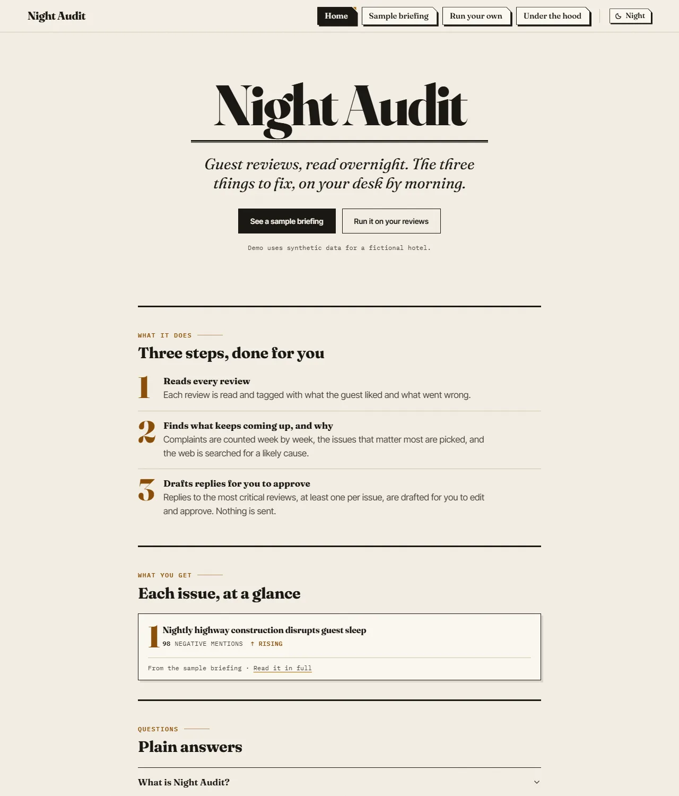
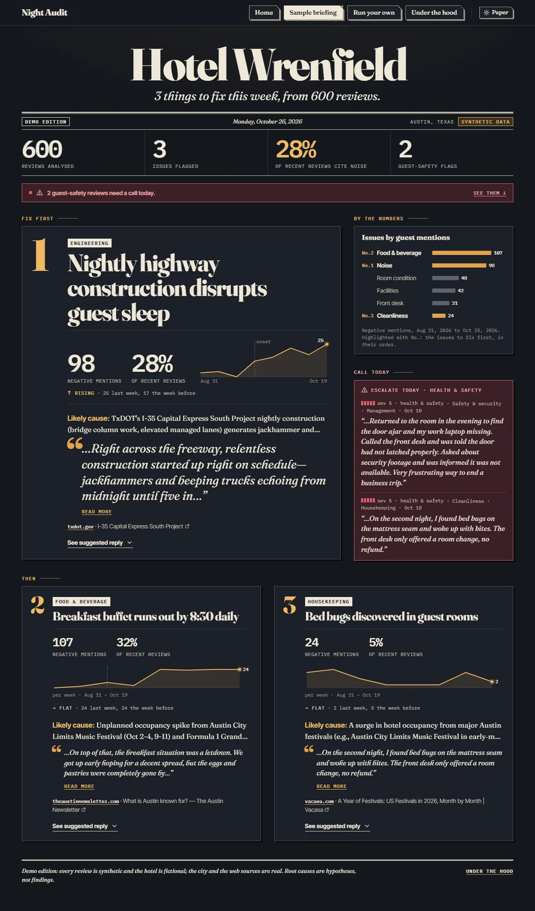
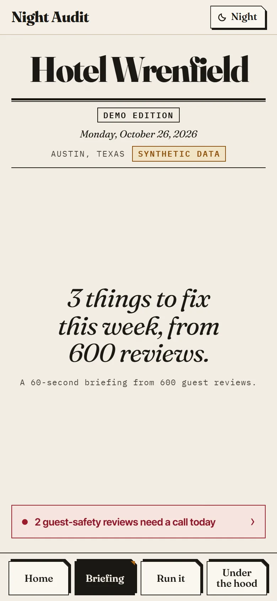
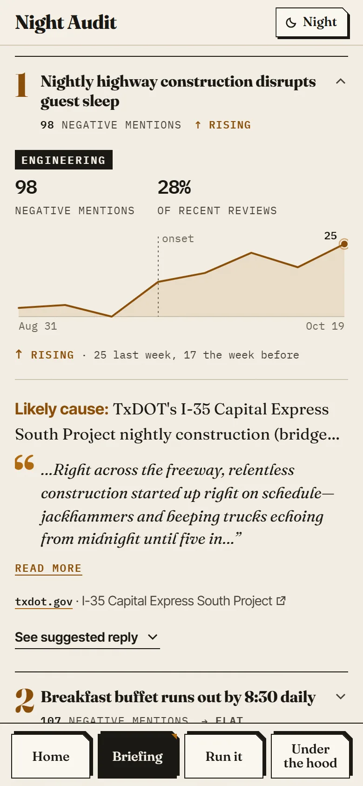
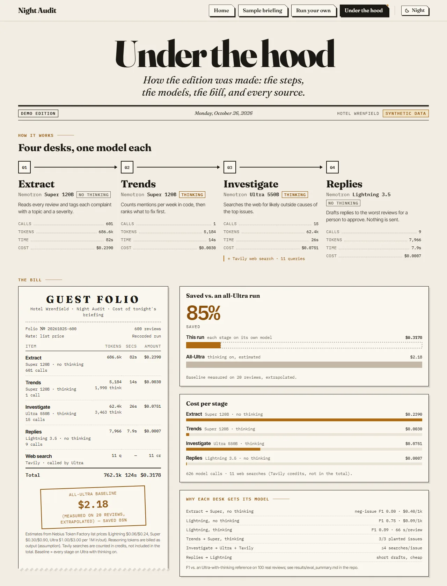
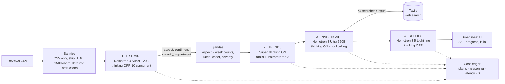

# Night Audit

**A morning-briefing agent for hotel general managers.** Overnight it reconciles every guest review into the
three issues to fix this week: the trend behind each one, a web-researched root-cause hypothesis with cited
sources, prioritized actions with an owner, reply drafts for approval, and a bill showing what the briefing
cost and why routing between models keeps it cheap.

Built for the **Nebius × NVIDIA Global AI Hackathon, track "Best Apps and Agents"**, using NVIDIA Nemotron
models on **Nebius Token Factory** and **Tavily** for runtime web search.

- **Live demo:** `https://night-audit.onrender.com` (free, no sign-in; demo edition needs no model calls)
- **Demo video:** `<link>`
- **License:** MIT (see [LICENSE](LICENSE))

The app has four tabs:

- **Home:** what Night Audit does, one issue from the sample briefing, and plain answers about data and limits.
- **Sample briefing:** the demo edition: the three issues to fix, likely causes with sources, guest-safety reviews, draft replies.
- **Run your own:** upload a CSV of up to 150 reviews for a live run (rate-limited and spend-capped).
- **Under the hood:** how the briefing was made: the four model desks, the bill, and every source.



*Home: the promise, two ways in, the three steps, and one issue from the sample briefing.*

<table>
  <tr>
    <td width="56%"></td>
    <td width="22%"></td>
    <td width="22%"></td>
  </tr>
</table>

*Sample briefing: the full front page on desktop (night theme); on a phone, the first screen and issue #1 opened.*



*Under the hood: one model per desk, metered, and the bill for the whole briefing.*


*Run your own: the upload form for a live run on your reviews.*

<sub>Screenshots show the demo edition (synthetic reviews for a fictional hotel).</sub>

> **The demo data is synthetic.** Hotel Wrenfield is a fictional hotel in a real city (Austin, Texas). All 600
> demo reviews were written by Nemotron Lightning from a scenario planted in code
> ([scripts/gen_synthetic.py](scripts/gen_synthetic.py)), so the pipeline can be checked against a known answer.
> The web sources the agent cites are real.

---

## What the GM gets

| | |
|---|---|
| **Top 3 issues** | A lead story and two secondaries. Each has a headline, a weekly sparkline with the onset week found in code, and a short interpretation built on exact counts. |
| **Investigation** | For each issue, Nemotron Ultra runs a capped Tavily search loop and returns root-cause **hypotheses** (labeled as such, with a confidence level and an external/internal tag), evidence with numbered citations, 3 prioritized actions with owning department and timeframe, and a line on what to tell guests. |
| **Escalations** | Severity-5 incidents (pests, theft, injury) are pulled out separately, so a single report is never lost in the averages. |
| **Replies for approval** | Drafts for the most severe negative reviews. Approve, edit, discard, or copy. Nothing is sent anywhere. |
| **Guest folio** | Every model call is metered: tokens, reasoning tokens, seconds and cost per stage, compared against an all-Ultra baseline that was measured, not assumed. |
| **The ledger** | All 11 aspects × 8 weeks, counted in pandas. |

Two modes: **Demo edition** (cached real run, instant, zero cost, can replay the run's live progress) and
**Live** (upload a CSV of up to 150 reviews; streams progress over SSE; rate-limited and spend-capped).

## How it works



The pipeline is an async generator ([src/pipeline.py](src/pipeline.py)) that yields progress events. FastAPI streams
them to the browser over SSE ([src/api.py](src/api.py)), and the React frontend (`frontend/`) shows them as a
ledger reconciliation with the folio filling in. One process serves both the API and the built frontend.

**LLMs never count.** Counts, rates, week-over-week changes, onset detection and severity averages are pandas
([src/trends.py](src/trends.py)). Super receives the computed table plus a few quoted snippets and ranks and
explains; its output is validated against the table.

## Model routing (decided by measurement)

Each stage uses a different model on purpose, and the choice for each one comes from an eval rather than a guess.

| Stage | Model on Token Factory | Thinking | Why |
|---|---|---|---|
| Extract | `nvidia/nemotron-3-super-120b-a12b` | off | Best quality per dollar that passed the pre-registered rule (below). |
| Trends | `nvidia/nemotron-3-super-120b-a12b` | **on** | Same top 3 as thinking off, but more specific headlines, for about $0.002 more. |
| Investigate | `nvidia/Nemotron-3-Ultra-550b-a55b` | **on** | Multi-step tool use and reasoning over web evidence. Hard-capped at 4 searches per issue. |
| Replies | `nvidia/Nemotron-3_5-Lightning` | off | Short, constrained drafts. Cheapest and fastest. |

### Extraction eval ([results/eval_summary.md](results/eval_summary.md))

100 real hotel reviews (Datafiniti, used locally only) plus 160 synthetic reviews. The real reviews are scored
against a **silver reference: Ultra with thinking ON**, i.e. the expensive all-Ultra baseline. The hand-label
sheet had 0 rows labeled when this ran; `scripts/run_eval.py` switches to human labels automatically once ≥30
rows are labeled. The synthetic reviews are scored against the aspects planted in code.

| config | neg-issue F1 vs silver (real) | neg-issue F1 vs planted (synthetic) | mean latency / review | JSON fail after retry | cost / 1k reviews |
|---|---|---|---|---|---|
| Lightning, thinking off | 0.75 | 0.79 | 1.7 s | 0% | $0.09 |
| Lightning, thinking on | 0.89 | 0.91 | **65.9 s** | 1.5% | $1.23 |
| **Super, thinking off** ✔ | **0.80** | **0.86** | 1.4 s | 0% | **$0.40** |
| Ultra, thinking off | 0.88* | 0.93 | 1.6 s | 0% | $1.34 |
| Ultra, thinking on (reference) | — | — | 5.5 s | 0% | $4.27 |

\* inflated: same model as the reference.

**Rule (fixed before the final run):** take the cheapest config with ≤2% JSON failures that recovers at least 2 of
the reference's top-3 issues on every reference, and whose negative-issue F1 is within 0.10 of the best config
(Ultra excluded from "best" because it is the reference). Lightning thinking-off is 5× cheaper but falls short on
review-level quality. Lightning thinking-on matches Ultra's quality but reasons about 4,700 tokens per short review
and is about 45× slower. **Super with thinking off** is the sweet spot. The original plan had been Lightning; the
data changed it.

### Trends eval ([results/eval_trends.md](results/eval_trends.md))

Super with thinking ON and OFF both recovered the planted top 3 in 2/2 runs (top-3 precision 1.00). Thinking ON
writes headlines like *"Breakfast buffet depleted by 8:30 AM"*; thinking OFF writes *"Food & beverage complaints
surge past 30% in recent weeks"*. We kept thinking ON.

## Results on the demo hotel

Planted story (see `data/synthetic/ground_truth.json`): breakfast breakdown from week 5, overnight highway
construction noise from week 4, one theft and one bed-bug report, all over a stable background.

| Check | Result |
|---|---|
| Top-3 precision vs planted story | **1.00**: noise, food & beverage, bed bugs |
| Both planted trends recovered | yes |
| Both severity-5 incidents escalated | yes (theft, bed bugs) |
| Weekly F&B negatives, planted → detected | `0 1 7 3 24 24 24 24` → `0 2 7 3 24 23 24 24` |
| Weekly noise negatives, planted → detected | `3 4 0 11 15 22 17 25` → `3 4 0 12 15 22 17 25` |
| Noise root cause found by the agent | TxDOT **I-35 Capital Express** nightly closures (real coverage cited) |
| Breakfast root cause found by the agent | ACL Fest and F1 weekend occupancy surges outrunning static breakfast par levels |

**Cost of the briefing (600 reviews):** $0.318 routed, against **$2.18 for all-Ultra-with-thinking** (measured on a
20-review sample at $0.185 and extrapolated per stage), so **85% saved**. Extraction is 75% of the routed cost, and
that is where routing pays off.

| Stage | Calls | Seconds | Cost |
|---|---|---|---|
| Extract (Super, off) | 601 | 82 | $0.2390 |
| Trends (Super, on) | 1 | 14 | $0.0030 |
| Investigate (Ultra, on) + 11 Tavily searches | 15 | 26 | $0.0751 |
| Replies (Lightning, off)¹ | 9 | 7.9 | $0.0007 |
| **Total** | **626** | **124** | **$0.3178** |

¹ The demo replies were re-drafted after the reply prompt changed (5 drafts plus 4 rewrites asked for by the
commitment check), with `scripts/redraft_demo_replies.py`; the folio bills those calls. The total's seconds are
the original run's wall time.

A live run on 120 reviews took 66 s and cost $0.12.

## How Nemotron, Token Factory and Tavily are used

- **Token Factory, OpenAI-compatible:** one `openai` client per base URL ([src/config.py](src/config.py)).
  Lightning is served from `api.tokenfactory.nebius.com`; Super and Ultra from `api.tokenfactory.us-central1.nebius.com`.
- **Thinking control:** `extra_body={"chat_template_kwargs": {"enable_thinking": False}}`. Reasoning tokens count
  against `max_tokens`, so thinking calls get bigger budgets, and every call checks `finish_reason == "length"`.
  `completion_tokens` includes reasoning tokens (verified: 337 completion = 332 reasoning + 5 answer).
- **JSON robustness:** `response_format={"type":"json_object"}`, plus `extract_json()` (strips code fences, finds
  the first `{` and last `}`, drops trailing commas), plus one retry ([src/jsonutil.py](src/jsonutil.py)).
- **Ultra tool calling (native):** [src/investigate.py](src/investigate.py) passes a `web_search` function tool.
  Ultra decides the queries, Tavily runs at runtime, and the results come back as `role: tool` messages. The
  4-search cap is enforced in code (`tool_choice="none"` once it is reached). Sources are numbered as they arrive.
  Only URLs returned by Tavily can be cited; citation IDs the model invents are dropped. If tool calling ever errors,
  a fallback runs Tavily directly and passes the results into a single prompt (tested first, see FEEDBACK.md;
  native calling worked, so the fallback has not been needed).
- **Tavily:** `TavilyClient.search(search_depth="basic", max_results=5, time_range=...)` with a 7-day on-disk
  cache. Each search shows in the UI's evidence trail and in the folio's credit count.
- **Cost ledger:** every call logs model, tokens in/out, reasoning tokens, latency and cost to a context-local
  ledger ([src/cost_tracker.py](src/cost_tracker.py)). The ledger feeds the folio and the spend cap.

## Setup

Requirements: Python 3.11+ (tested locally on 3.13 and 3.14; the Docker image uses 3.12) and Node 20.19+ (only for building the frontend).

**Windows (PowerShell)**
```powershell
git clone <repo-url> night-audit; cd night-audit
py -3 -m venv .venv
.\.venv\Scripts\Activate.ps1
pip install -r requirements-dev.txt
Copy-Item .env.example .env        # then edit .env and paste your keys
cd frontend; npm ci; npm run build; cd ..
uvicorn src.api:app --port 8000
```

**macOS / Linux (bash)**
```bash
git clone <repo-url> night-audit && cd night-audit
python3 -m venv .venv && source .venv/bin/activate
pip install -r requirements-dev.txt
cp .env.example .env               # then edit .env and paste your keys
(cd frontend && npm ci && npm run build)
uvicorn src.api:app --port 8000
```

Open http://localhost:8000. The demo edition works with no keys at all. Live mode needs both keys.

**Frontend dev with hot reload:** keep uvicorn running, then `cd frontend && npm run dev` and open
http://localhost:5173 (Vite proxies `/api` to port 8000).

**Tests:** `pytest -q` (offline: JSON repair, cost math, CSV parsing, limits, API). Add `RUN_LIVE=1` to also make
one real call per model (PowerShell: `$env:RUN_LIVE=1; pytest tests/test_live_models.py`).

### Environment variables

| Variable | Default | Purpose |
|---|---|---|
| `NEBIUS_API_KEY` | (required for live) | Nebius Token Factory key |
| `TAVILY_API_KEY` | (required for live) | Tavily key |
| `SPEND_CAP_USD` | `5` | Hard cap on estimated live spend. When it is reached, live mode switches off and the UI falls back to the demo. |
| `PER_IP_DAILY_RUNS` | `3` | Live runs per visitor IP per UTC day (IPs are stored hashed) |
| `GLOBAL_DAILY_RUNS` | `30` | Live runs per day across everyone |
| `MAX_CONCURRENT_RUNS` | `2` | Simultaneous live runs |
| `MAX_REVIEWS_PER_UPLOAD` | `150` | Larger files keep the most recent 150 |
| `MAX_UPLOAD_BYTES` | `1000000` | Upload size limit |
| `MAX_RUN_COST_USD` | `0.60` | Per-run budget, checked between stages |
| `LIVE_MODE_ENABLED` | `1` | `0` = demo-only kill switch |
| `UPSTASH_REDIS_REST_URL` / `_TOKEN` | (unset) | Optional durable spend counter (free Upstash Redis) for hosts whose disk resets |
| `SPEND_FILE` | `data/runtime/live_spend.json` | File-backed spend counter location |
| `STRICT_KEYS` | (unset) | `1` = refuse to start when keys are missing (by default the server starts demo-only and prints a loud warning) |

## Reproducing the results

```bash
python scripts/probe_api.py          # token accounting + Ultra tool calling check (~$0.003)
python scripts/run_eval.py           # extraction eval -> results/eval_summary.md (~$0.80 first run; silver is cached)
python scripts/gen_synthetic.py      # 600 synthetic reviews + ground truth (~$0.03)
python scripts/eval_trends.py        # trends thinking on/off -> results/eval_trends.md (~$0.25 incl. extraction)
python scripts/build_demo.py         # real pipeline + 20-review all-Ultra baseline -> demo_result.json (~$0.50)
```
`run_eval.py` reads your hand labels from `data/eval/label_sheet.csv` (`aspect:sentiment:severity; ...` or `none`;
check them with `scripts/check_labels.py`). It prints how many rows are labeled and says in the summary when fewer
than 30 are. Each script prints a running dev-spend estimate. Total development spend was about $3.

## Deploying (Render, free)

1. Push this repo to GitHub (public).
2. On [render.com](https://render.com): **New → Blueprint**, then pick the repo. `render.yaml` defines one free
   Docker web service.
3. When prompted, paste `NEBIUS_API_KEY` and `TAVILY_API_KEY`. Leave the other values at their defaults.
4. Recommended: create a free Upstash Redis database and paste its REST URL and token. Without them the spend
   counter lives on Render's disk, which resets on every redeploy or restart.
5. Deploy. The health check is `/api/health`. The URL is `https://night-audit-<id>.onrender.com`.

Free Render services sleep after 15 minutes idle, and the first request then takes about 30–60 s. For judging,
open the URL a minute before you need it. The demo edition never calls a model, so it keeps working after the
spend cap trips, when keys are missing, or when Token Factory is unreachable.

## Safety and cost controls

- Hard spend cap (persisted), per-IP and global daily run limits, a concurrent-run limit, upload size and review
  caps, and a per-run budget. The cap is checked before every stage, so a run in progress stops itself (tested:
  "global spend cap reached before trends"). Worst-case overshoot is one stage, about $0.08.
- If the client disconnects, the run is cancelled.
- Investigation is limited to the top 3 issues with 4 searches each, enforced in code.
- Uploads: `.csv` only; binary rejected; text column auto-detected; HTML stripped; control characters removed;
  each review truncated to 1,500 chars. Review text and web content are passed as quoted JSON strings, and every
  prompt says they are data, never instructions.
- Keys are read from the environment only, never logged, and never sent to the browser. Missing keys produce a
  loud startup banner (live mode off) or, with `STRICT_KEYS=1`, a refusal to start.
- Security headers include a strict CSP (no third-party scripts; fonts are self-hosted from npm).

## Data and licensing

- **Code:** MIT.
- **Demo data:** synthetic, generated by this repo, committed in `data/synthetic/`.
- **Evaluation data:** [Datafiniti Hotel Reviews](https://www.kaggle.com/datasets/datafiniti/hotel-reviews)
  (CC BY-NC-SA 4.0), © Datafiniti. Used **only for local evaluation**. It is gitignored (`data/raw/`, `data/eval/`,
  `results/*.jsonl`) and is **not redistributed** in this repo or shown in the app. Only aggregate metrics appear
  in `results/`.

## Limitations (honest)

- **No human-labeled ground truth yet.** Extraction quality was measured against Ultra-with-thinking (silver) and
  against synthetic planted aspects. Neither substitutes for a hotel professional's labels; re-run
  `run_eval.py` once the label sheet is filled in.
- **The headline validation is on synthetic data**, written by a Nemotron model from a known plan. Real reviews
  are messier. The pipeline handles glued manager replies and "...More" truncation, but how well it ranks issues
  on a real hotel's reviews is untested.
- **Root causes are hypotheses.** Tavily's basic search returns some low-quality pages (social posts, listicles).
  The agent cites what it found and labels confidence, but it can over-read a coincidence, such as a festival
  that happens to fall in the same weeks.
- **Web search reflects today's web, not the review period.** An old review set (say, reviews that end in 2019)
  gets weak or irrelevant sources: today's news can't explain a complaint from years ago, and most older pages are
  filtered out as stale. Live runs show a note above the investigation when the newest review is more than 90
  days old.
- **Mold is always scored severity 5**, so a cosmetic mention ("a little mold on the shower grout") can be
  escalated like a health hazard. Check the excerpt before acting on a mold escalation.
- **Costs are estimates** from list prices. Billing reasoning tokens at the output rate is an assumption not yet
  checked against an invoice. Tavily credits are shown but not converted to dollars.
- **The baseline is extrapolated** from a 20-review all-Ultra sample (extraction scales per review; investigation
  per issue; replies per draft).
- **Limits are per process.** Run one worker. On Render's free tier, counters reset on restart unless Upstash is
  configured.
- Very small uploads (under about 4 weeks or under about 50 reviews) give weak trend signals. The UI still works,
  but "vs before" comparisons are noisy.
- English only.

## Repository map

```
src/            config (models, clients, call_model) · cost_tracker · ingest · extract · trends
                investigate · replies · pipeline · limits · api
scripts/        probe_api · run_eval · gen_synthetic · eval_trends · build_demo
                (+ the original explore_data / make_eval_sampler / make_label_sheet / check_labels / smoke_test)
frontend/       React + Vite + TypeScript broadsheet UI
data/synthetic/ reviews.csv · ground_truth.json · demo_result.json   (committed)
results/        eval_summary.md · eval_trends.md · eval_decision.json (committed; raw jsonl gitignored)
tests/          pytest suite
FEEDBACK.md     running build notes (findings, failures, decisions)
DEMO_SCRIPT.md  2:45 shot list for the demo video
```
